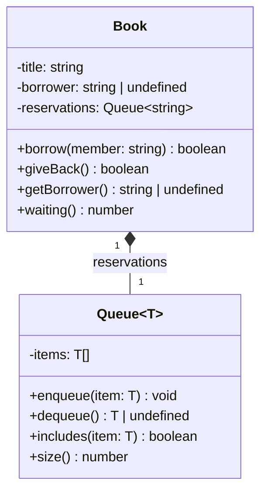

# Lab 4 — Generics in Practice: Answers

## Part 1 — The Problem

Prediction 1. No line is underlined, because `any` switches the checks off. At runtime `console.log(awa.getName())` prints `Awa`, then `awa.describe()` crashes with `TypeError: awa.describe is not a function`.

Question 1. The `any` version gave up type checking: no autocomplete and no errors for wrong calls. `memberList.add(42)` would not be caught by the editor. It crashes at runtime with `TypeError: item.getId is not a function`.

## Part 2 — A Generic Catalog

Question 2. `Property 'getId' does not exist on type 'T'. ts(2339)`. `T` could be any type (a `number`, a `string`...), so TypeScript only allows what is guaranteed for every possible `T`. Nothing says that `T` has `getId()`.

Checkpoint 1 is reached (output matches).

Question 3.TypeScript uses structural typing: a type is accepted if it has the required shape. `Book` and `Member` both have `getId(): string`, which is all `HasId` asks. No `implements` is needed.

Question 4.
- (a) `books.add(new Member(...))` — TypeScript prevented putting a member into the book catalog; `new Catalog<Book>()` fixed `T` to `Book` and `add(item: T)` uses `T`. Error: `Type 'Member' is missing the following properties from type 'Book': title, describe`.
- (b) `new Catalog<number>()` — TypeScript prevented a catalog of something with no `getId()`; this is made possible by the constraint `T extends HasId`. Error: `Type 'number' does not satisfy the constraint 'HasId'`.
- (c) `found.describe()` without `if` — TypeScript prevented calling a method on a value that may be `undefined`; `find` is declared as returning `T | undefined`. Error: `'found' is possibly 'undefined'`.

Prediction 2.No test line needs to change.

**Question 5.** The `items` field is `private` and the public signatures (`add`, `find`, `count`) did not change. Callers only know the outside, so changing the inside does not affect them. This is encapsulation.

**Question 6.** With the array version, if `all()` returned `this.items`, a caller could write `books.all().push(new Book("B-001", "Duplicate"));`. This adds directly into the internal array and skips the duplicate check of `add`. Returning a new array means `push` changes only the copy, not the catalog. (The items inside are still shared: the copy is shallow.)

## Part 3 — Generic or Not?

**Checkpoint 2** is reached (`9050`, `0`).

**Question 7.** `Property 'describe' does not exist on type 'Borrowable'. ts(2339)`. The return type is `Borrowable | undefined`, so TypeScript only knows what that type promises (`lateFee`). It does not remember that the real object is a `Dvd`.

**Generic version.**
```typescript
function mostCostly<T extends Borrowable>(items: readonly T[], daysLate: number): T | undefined
```

**Prediction 3.** `worstOverall` has type `Book | Laptop | undefined`. `worstOverall.describe()` is refused: `Property 'describe' does not exist on type 'Book | Laptop'` (`Laptop` has no `describe`). `lateFee(3)` is accepted and prints `8000`.

**Question 8.** A generic is worth it when the function returns **an element (or a part) of its input, so the type of the result depends on the type of the input**. `totalFees` always returns a `number`. In Prediction 3, `T` was inferred from the mixed array as the union `Book | Laptop`, so only what both types have is allowed; the `T` constraint (`Borrowable`) guarantees `lateFee`.

## Part 4 — A Generic Class as a Part

**Checkpoint 3** is reached (output matches).

**Question 9.** `T` is chosen inside `Book`, in the field `private reservations: Queue<string> = new Queue<string>();`, and it is `string` (member names). With `class Book extends Queue<string>`, anyone could write `book.enqueue("Awa")` (adds a member without the rules, even a duplicate or the current borrower) or `book.dequeue()` (removes a member without `giveBack`).

**Question 10.** First call: Moussa did not have the book and was not waiting, so he **joined the queue**. Second call: he was **already waiting**, so nothing changed. The caller cannot tell the reason from a `boolean`: joined the queue, already waiting, already has the book, they all look like `false` (and the position in the queue is unknown).

**Task 3 — Diagram**



**Question 11.** Composition. The queue is created inside `Book`, is private, is never shared, and disappears with the book. `Book` **has a** queue, it **is not a** queue (so no inheritance).

## Part 5 — What Generics Cannot Do

**Prediction 4.** Red underline: `'T' only refers to a type, but is being used as a value here. ts(2693)`. Running anyway does not print `true` or `false`: it stops with `ReferenceError: T is not defined`.

**Prediction 5.** `Things Fall Apart` and `NaN` (`undefined + 1`).

**Question 12.** `node` only removes the types and does not check them: types are erased at runtime. So `T` does not exist when the code runs (`instanceof T` fails), and `<BookData[]>` is only a promise to the compiler: `JSON.parse` returns whatever is in the text, and `copies` is missing. Data from outside the program (JSON, files, user input, network) must be checked at runtime when it enters, with real checks (`typeof`, `Array.isArray`, validation functions or a library).

## Part 6 — Your Turn

**Checkpoint 4** is reached (output matches).

**Question 13.** If `best()` returned `HasId`, the caller could only call `getId()`. It could no longer call `top.describe()`: the `Book` type would be lost.
